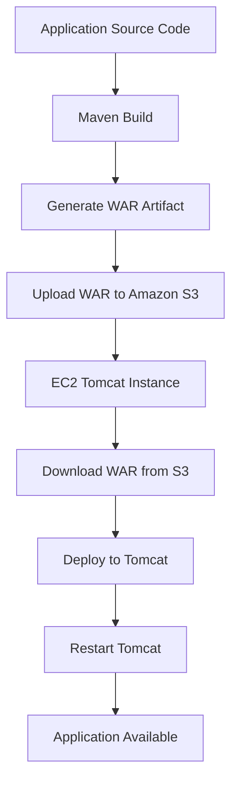

# AWS Automated Application Deployment and Auto Scaling

## Project Overview

This project demonstrates the deployment of a multi-tier Java web application on Amazon Web Services (AWS), using cloud infrastructure, deployment automation, load balancing and automatic scaling.

The project uses the VProfile application as its workload. The infrastructure includes EC2 instances for the application and backend services, an Application Load Balancer (ALB), an Auto Scaling Group, Amazon S3 for application artifact storage, and DNS configuration for external access and internal service discovery.

Application deployment is automated using Bash scripts, Maven and the AWS CLI. The application is built, uploaded to S3 and subsequently deployed onto EC2 instances running Apache Tomcat.

The deployment was successfully tested. I accessed the application through the Application Load Balancer, logged in and used the application. I also verified that the Auto Scaling Group could scale instances up and down.

## Architecture

The infrastructure consists of a load-balanced Tomcat application tier and supporting backend services.

### AWS infrastructure architecture


### Architecture components

| Component | Responsibility |
|---|---|
| GoDaddy DNS | Public DNS configuration directing users to the load balancer endpoint |
| Application Load Balancer | Receives incoming application traffic and distributes requests |
| EC2 Tomcat instances | Host and run the VProfile Java application |
| Auto Scaling Group | Manages the number of Tomcat instances based on configured scaling conditions |
| Security Groups | Control network traffic between infrastructure components |
| Amazon Route 53 Private DNS | Provides internal DNS resolution for backend services |
| MySQL instances | Provide relational database services |
| Memcached instances | Provide caching services |
| RabbitMQ instances | Provide message brokering |

### Application request flow

The main application access path is:

**User → Public DNS (GoDaddy) → Application Load Balancer → Tomcat EC2 instances → VProfile application**

The Application Load Balancer receives incoming HTTPS traffic and forwards application requests to the Tomcat instances over HTTP on port 8080.

The Tomcat instances are managed by an Auto Scaling Group, allowing the application tier to adjust its capacity according to the configured scaling conditions.

### Internal service discovery

Amazon Route 53 private DNS was configured to allow application components to locate backend services using internal DNS names.

The private DNS records shown in the architecture include:

- `db01`
- `mc01`
- `rmq01`

This allows the application environment to use service names rather than depending directly on individual IP addresses.

## Application Build and Deployment Workflow

The project separates application building from application deployment.

Amazon S3 acts as the intermediary storage location for the compiled application artifact.

### Deployment workflow



### 1. Application build and artifact upload

The `build_and_upload.sh` script automates the application build and upload process.

The script uses Maven to generate the WAR deployment artifact:

```bash
mvn clean package -DskipTests
```

After the build completes, the script checks for the generated WAR file and uploads it to the configured Amazon S3 bucket using the AWS CLI.

This separates the build process from the EC2 deployment environment.

**Note:** Automated Maven tests are skipped in this build configuration.

### 2. Application deployment on EC2

The `deploy_on_ec2.sh` script automates the deployment process on the EC2 application instances.

The script performs the following operations:

1. Retrieves the application WAR file from Amazon S3.
2. Copies the artifact into the Tomcat web applications directory.
3. Restarts the Tomcat service.
4. Makes the deployed application available through the application server.

The application is deployed as the Tomcat ROOT application.

### 3. Load balancing

An Application Load Balancer was configured to distribute incoming application traffic across the Tomcat instances.

Public DNS was configured to direct users to the load balancer endpoint.

The application was successfully accessed through the load balancer rather than by connecting directly to an individual EC2 instance.

### 4. Auto Scaling

An Auto Scaling Group was configured to manage the capacity of the Tomcat application tier.

Scaling behaviour was tested, and EC2 instances were successfully added and removed according to the configured scaling conditions.

This demonstrated how the application infrastructure could adjust its capacity rather than relying on a fixed number of application instances.

## Repository Structure

```text
AWS-deployment/
├── README.md
├── build_and_upload.sh
├── deploy_on_ec2.sh
├── userdata/
└── docs/
    └── aws-architecture.png
```

## Automation Scripts

### `build_and_upload.sh`

Responsible for:

- Building the Java application using Maven.
- Generating the WAR deployment artifact.
- Checking for the expected build output.
- Uploading the artifact to Amazon S3.

### `deploy_on_ec2.sh`

Responsible for:

- Downloading the WAR artifact from Amazon S3.
- Copying the artifact into the Tomcat web applications directory.
- Restarting the Tomcat service.

These scripts demonstrate the use of Bash and the AWS CLI to automate application build and deployment operations.

## AWS Services and Technologies

| Technology | Purpose |
|---|---|
| Amazon EC2 | Hosts application and backend service instances |
| Amazon S3 | Stores application deployment artifacts |
| Application Load Balancer | Distributes incoming application traffic |
| Auto Scaling Groups | Manages application instance capacity |
| Amazon Route 53 | Private DNS and internal service discovery |
| IAM | Identity and access management |
| Security Groups | Network traffic control |
| Apache Tomcat | Java application server |
| Maven | Application build automation |
| Bash | Build and deployment scripting |
| AWS CLI | AWS service interaction |
| GoDaddy DNS | Public DNS configuration |
| Git | Source code management |

## Deployment Verification

The project was tested through the following activities:

- Created EC2 instances for the backend services and Tomcat application tier.
- Configured Route 53 private DNS for communication between backend services.
- Built the application using Maven.
- Uploaded the generated WAR artifact to Amazon S3.
- Successfully deployed the application from S3 onto EC2/Tomcat.
- Configured an Application Load Balancer and accessed the application through its endpoint.
- Configured an Auto Scaling Group and verified that instances scaled up and down.
- Successfully logged into and used the deployed VProfile application.

These tests verified the application build and deployment workflow, load-balanced access and the scaling behaviour of the application infrastructure.

## Skills Demonstrated

Through this project, I gained practical experience with:

- AWS cloud infrastructure.
- EC2 instance provisioning and management.
- IAM roles and permissions.
- Security group configuration.
- Public and private DNS configuration.
- Route 53 private service discovery.
- Amazon S3 artifact storage.
- Maven application builds.
- Bash scripting and deployment automation.
- AWS CLI.
- Apache Tomcat administration.
- Application Load Balancing.
- Auto Scaling Groups.
- Multi-tier application architecture.
- Cloud infrastructure troubleshooting.
- Separation of application build and deployment processes.

## Future Improvements

Potential improvements to the project include:

- Introducing Terraform for Infrastructure as Code.
- Implementing a CI/CD pipeline for automated application builds and deployments.
- Introducing HTTPS termination and certificate management using AWS Certificate Manager.
- Improving secrets management using AWS Systems Manager Parameter Store or AWS Secrets Manager.
- Applying least-privilege IAM policies.
- Adding automated deployment validation and health checks.
- Improving infrastructure monitoring and centralised logging.
- Exploring rolling and blue-green deployment strategies.

## Author

**GitHub:** [Wilm12](https://github.com/Wilm12)

**Repository:** [AWS Automated Application Deployment](https://github.com/Wilm12/AWS-deployment)
