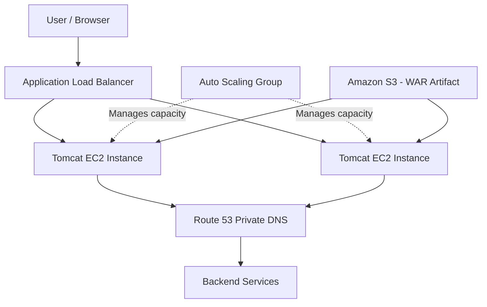

# AWS Automated Application Deployment and Scaling

## Project Overview

This project demonstrates the deployment of a Java web application on Amazon Web Services (AWS), using a scalable infrastructure architecture built around EC2, S3, an Application Load Balancer and an Auto Scaling Group.

The project uses the VProfile application as its workload and demonstrates how application builds can be separated from deployment by storing versioned build artifacts in Amazon S3 before deploying them to EC2 instances running Apache Tomcat.

The infrastructure includes dedicated EC2 instances for backend services, private DNS-based service discovery through Route 53, and a load-balanced application tier capable of scaling based on demand.

The deployment was successfully tested. I accessed the application through the Application Load Balancer, logged in and used the application, and verified that the Auto Scaling Group could scale instances up or down.

## Architecture

The deployment uses the following AWS services:

| AWS Service | Responsibility |
|---|---|
| Amazon EC2 | Hosts application and backend service instances |
| Amazon S3 | Stores the compiled Java WAR artifact |
| Application Load Balancer | Distributes incoming HTTP traffic across application instances |
| Auto Scaling Group | Automatically adjusts the number of application instances |
| Route 53 Private Hosted Zone | Provides private DNS names for communication between services |
| IAM Roles | Provides permissions for AWS resource access |
| Security Groups | Controls network traffic between infrastructure components |

### Architecture flow

The application deployment follows this general workflow:

1. The Java application is built using Maven.
2. The generated WAR artifact is uploaded to an S3 bucket.
3. EC2 application instances retrieve the WAR file from S3.
4. The application is deployed to Apache Tomcat.
5. The Application Load Balancer distributes incoming requests to the application instances.
6. The Auto Scaling Group manages the number of application instances.
7. Route 53 private DNS allows application components to communicate using internal DNS names.

### Architecture diagram



## Deployment Workflow

### 1. Infrastructure provisioning

The AWS environment was configured with the required infrastructure components:

- EC2 instances for backend services and the application tier.
- IAM roles for AWS service permissions.
- Security groups to control network access.
- A Route 53 private hosted zone for internal service discovery.
- An Application Load Balancer.
- An Auto Scaling Group for the application instances.

### 2. Private DNS configuration

Route 53 private DNS was configured to allow application components to communicate using internal DNS names rather than relying directly on changing IP addresses.

The application configuration uses service names such as:

- `db01`
- `mc01`
- `rmq01`

This provides a more manageable approach to internal service discovery.

### 3. Application build and artifact storage

The application is built using Maven.

The `build_and_upload.sh` script automates the build and upload process:

```bash
mvn clean package -DskipTests
```

The generated WAR file is uploaded to Amazon S3 using the AWS CLI.

This separates the application build process from the deployment environment.

### 4. Application deployment

The `deploy_on_ec2.sh` script automates application deployment on the EC2 Tomcat instance.

The script:

1. Retrieves the WAR artifact from S3.
2. Copies it into Tomcat's web applications directory.
3. Restarts the Tomcat service.
4. Makes the deployed application available through the application server.

The application is deployed as the Tomcat ROOT application.

### 5. Load balancing

An Application Load Balancer was configured to distribute incoming HTTP traffic across the application instances.

The application was successfully accessed through the load balancer's DNS endpoint.

### 6. Auto Scaling

An Auto Scaling Group was configured to manage the application tier's EC2 capacity.

Scaling behaviour was tested, and instances were successfully added or removed in response to the configured scaling conditions.

## Repository Structure

```text
AWS-deployment/
├── README.md
├── build_and_upload.sh
├── deploy_on_ec2.sh
└── userdata/
```

The application source code is maintained separately from the infrastructure and deployment repository.

## Automation Scripts

### build_and_upload.sh

Responsible for:

- Building the Java application using Maven.
- Generating the WAR deployment artifact.
- Checking that the expected WAR file exists.
- Uploading the artifact to Amazon S3.

### deploy_on_ec2.sh

Responsible for:

- Retrieving the WAR artifact from S3.
- Copying it into the Tomcat web applications directory.
- Restarting the Tomcat service.

Both scripts use Bash error handling to stop execution when commands fail.

## Technologies Used

| Technology | Purpose |
|---|---|
| Amazon Web Services | Cloud infrastructure |
| Amazon EC2 | Compute |
| Amazon S3 | Artifact storage |
| Application Load Balancer | Traffic distribution |
| Auto Scaling Groups | Application capacity management |
| Route 53 | Private DNS and service discovery |
| IAM | Access management |
| Security Groups | Network access control |
| Apache Tomcat | Java application server |
| Maven | Application build automation |
| Bash | Deployment automation |
| AWS CLI | Interaction with AWS services |
| Git | Source code management |

## Deployment Verification

The project was tested through the following activities:

- Successfully provisioned EC2 instances for backend services and the application tier.
- Configured private DNS resolution through Route 53.
- Built the Java application and uploaded the WAR artifact to S3.
- Successfully deployed the application from S3 to EC2/Tomcat.
- Configured an Application Load Balancer and accessed the application through its endpoint.
- Configured an Auto Scaling Group and verified scale-out and scale-in behaviour.
- Successfully logged into and used the deployed VProfile application.

These tests verified the application deployment workflow and the operation of the load-balanced, scalable application environment.

## Skills Demonstrated

This project provided practical experience with:

- AWS cloud infrastructure provisioning.
- EC2 instance management.
- IAM roles and permissions.
- Security group configuration.
- Private DNS and service discovery.
- S3 artifact storage.
- Maven application builds.
- Bash deployment automation.
- AWS CLI.
- Apache Tomcat deployment.
- Application Load Balancing.
- Auto Scaling Groups.
- Cloud application troubleshooting.
- Separation of application build and deployment processes.

## Future Improvements

Potential improvements to the project include:

- Introducing Infrastructure as Code using Terraform.
- Implementing a CI/CD pipeline for automated builds and deployments.
- Introducing HTTPS using AWS Certificate Manager.
- Replacing hardcoded configuration values with environment variables or managed configuration.
- Improving IAM policies using least-privilege permissions.
- Introducing automated health checks and deployment validation.
- Implementing more comprehensive monitoring and logging.
- Introducing deployment strategies such as rolling deployments or blue-green deployments.

## Author

**GitHub:** [Wilm12](https://github.com/Wilm12)

**Repository:** [AWS Automated Deployment](https://github.com/Wilm12/AWS-deployment)
